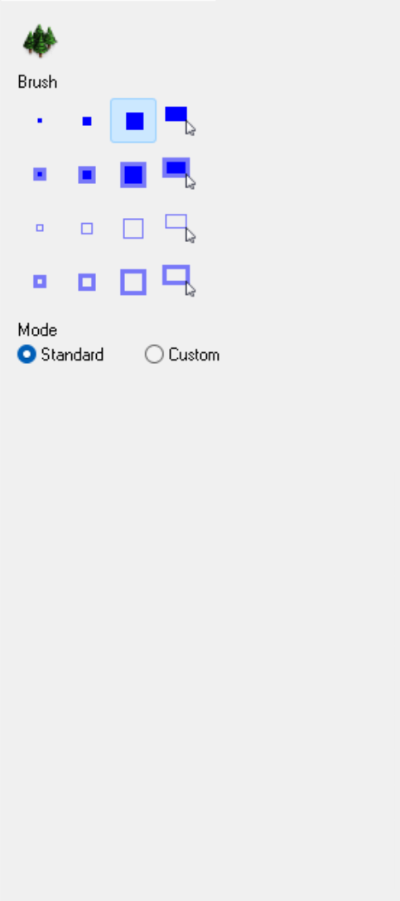
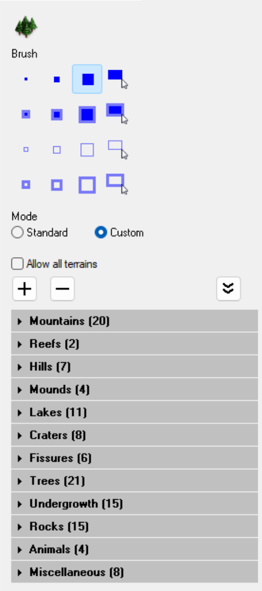
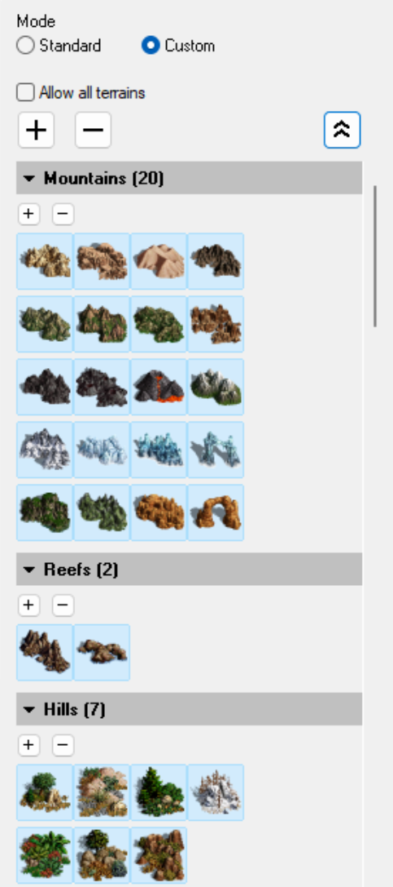
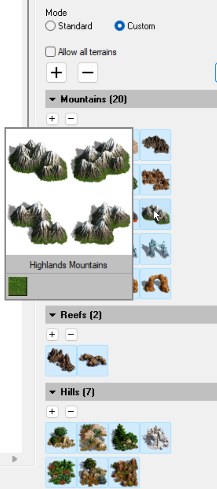

# HotA Custom Obstacle Tool

**Version: v0.9.2 · Author: Andarch**

Supports HotA 1.8.1 in English and Russian

This plugin adds a **Custom** mode to the map editor's Obstacle Tool so you can choose which
obstacles it generates and optionally allow all obstacles to be generated on any terrain type.
**Standard** mode keeps the editor's native obstacle placement, allowing you to still use the
native tool functionality while the plugin is loaded, and you can seamlessly switch between modes.

<table border="0">
  <tr>
    <td width="25%" valign="top">
      
    </td>
    <td width="25%" valign="top">
      
    </td>
    <td width="25%" valign="top">
      
    </td>
    <td width="25%" valign="top">
      
    </td>
  </tr>
</table>

## Features

- **Standard and Custom modes**, with tooltips explaining each mode. Standard
  preserves native obstacle generation; Custom allows you to choose what types
  of obstacles will be generated.
- **121 selectable obstacle buttons** covering 880 obstacle DEFs, organized into
  Mountains, Reefs, Hills, Mounds, Lakes, Craters, Fissures, Trees, Undergrowth,
  Rocks, Animals, and Miscellaneous.
- **Enables placement of many obstacles not supported by native placement**
  (maple trees, glaciers, ice formations, arches, animals, crates, barrels, ropes,
  sacks, abandoned boats, burnt structures, crumbled structures, bones).
- **Obstacle button hover previews** show examples of the obstacle types,
  obstacle names, and applicable terrains when the mouse cursor hovers the button.
- **Allow all terrains**, an optional setting that permits all obstacles to be
  generated on every terrain type (except Rock/Void). This setting is off by default
  and can be changed before or after painting. Button availability and hover previews
  reflect the option.
- **Selections and category expansion remembered within the session**, including
  when switching modes or leaving and reopening the obstacle tool.  
- **Supports English and Russian**, with the language of the editor automatically
  detected.

## Requirements

- Windows 10 or 11 with the Microsoft runtime listed below.
- An existing Heroes of Might and Magic III installation with the **official
  Horn of the Abyss 1.8.1 map editor** (`h3hota_maped.exe` and `hota_me.dll`).
  The plugin checks both binaries and rejects unsupported versions or modified builds.
- The latest **Microsoft Visual C++ v14 Redistributable (x86)**:
  [download the x86 installer from Microsoft](https://aka.ms/vc14/vc_redist.x86.exe).
  Install or update it before starting the tool. **The x86 package is required
  even on 64-bit Windows; the x64 package alone is insufficient.**

Both the launcher and plugin are 32-bit and use the Microsoft C++ runtime.
Microsoft requires the runtime to be at least as recent as the build tools used
for the release. See [Microsoft's runtime requirements and downloads](https://learn.microsoft.com/en-us/cpp/windows/latest-supported-vc-redist/).
You do not need Visual Studio, Excel, or the development workbook to use the tool.

## Download and installation

1. Open [Releases](https://github.com/Andarch/h3-hota-custom-obstacle-tool/releases)
   and download the tool's compiled release ZIP. GitHub's automatic **Source code**
   downloads contain the project sources, not the ready-to-run tool.
2. Extract the ZIP before launching. Keep these matching files together:
   - `HotACustomObstacleTool.exe`
   - `HotACustomObstacleTool.dll`
3. Place them in your HotA installation folder, beside `h3hota_maped.exe`, or keep
   them together in a separate writable folder.
4. Run **`HotACustomObstacleTool.exe`**. It starts the map editor with the plugin.
   It looks beside the launcher first, then checks a saved path, registry entries,
   and common installation locations. If it cannot locate HotA, select the folder
   containing `h3hota_maped.exe` when prompted.
5. Open the obstacle brush and select **Custom** to access the added controls.
   The editor starts in **Standard** mode each session.

The tool loads into the editor it starts; it does not attach to an editor you
already have open. Launching `h3hota_maped.exe` directly starts the normal editor.

If needed, set the installation path manually in `HotaMapEdPlugin.ini` beside the
launcher. Use the installation folder, not the path to the EXE:

```ini
[Settings]
HotaPath=C:\Games\Heroes3
```

The configuration filename retains its original name for compatibility. A manual
INI is optional; selecting a folder saves the path when the launcher folder is writable.
The editor's `Data` folder must also be writable for Custom generation's temporary
files. The tool does not overwrite original game executables, DLLs, or data tables.

## Using Custom mode

1. Select **Custom** mode in the Obstacle Tool.
2. Expand/collapse categories by clicking them, or use the **Expand/Collapse All** button.
3. Choose the obstacles you want generated by toggling the buttons in each category.
   By default, all obstacles are selected. You can use the global minus button to clear
   everything if you want to start with a smaller selection. Each category also has its
   own plus and minus button to select all/none in that category.
4. Optionally check **Allow all terrains** to allow all obstacles to be generated on
   any terrain.
5. Paint the area to fill, then use **Place Obstacles** or **Shift+O**.

You can set up selections before or after painting. When **Allow all terrains** is not
selected, once you start painting, obstacle buttons not valid for the painted terrain
will become greyed out. Generation needs at least one selected obstacle valid for the
painted area.

**Sand Dunes** use small dunes, and **Rough Lakes** use **Rough Rocks**, to fill
remaining painted gaps after the main placement pass, even when **Sand Hills** or
**Rough Rocks** are unchecked. These fillers follow the **Allow all terrains** setting.

Custom mode also corrects minimap shading for supported blocking obstacles.
Fully passable decorations keep their native colors.

Large obstacles may leave gaps or fail to generate in narrow painted areas. When
**Allow all terrains** is not selected, each obstacle needs enough painted space on compatible
terrain. A brush spanning a terrain boundary may provide too little space on either side.
Paint a wider area or include smaller obstacle types to improve coverage.

## Troubleshooting

| Problem | What to check |
| --- | --- |
| Missing `MSVCP140.dll` or `VCRUNTIME140.dll`, or the launcher cannot start | Install or repair the latest Microsoft Visual C++ v14 **x86** Redistributable linked above. |
| Missing `ucrtbased.dll`, `MSVCP140D.dll` or `VCRUNTIME140D.dll` | Use the matching EXE/DLL from the **Release** build. Debug builds require developer runtimes and are not distribution packages. |
| Plugin DLL not found | Extract the ZIP and keep the matching EXE and DLL in the same folder. |
| HotA cannot be found | Select the folder containing `h3hota_maped.exe`, or set `HotaPath` in the INI. |
| Unsupported editor or DLL version | Use the official HotA 1.8.1 editor and its matching `hota_me.dll`. Modified binaries may fail validation. |
| Custom controls are missing | Start the editor through `HotACustomObstacleTool.exe`, open the obstacle brush, and select Custom. |
| Place Obstacles is unavailable | Paint an eligible area and select at least one applicable obstacle button. Check the painted terrain and the Allow all terrains setting. |
| Custom generation fails | Check write access to the editor's `Data` folder and inspect the plugin log. |

The plugin writes **`HotaMapEdPlugin.log`** beside the DLL and replaces it at the
next startup. When [reporting an issue](https://github.com/Andarch/h3-hota-custom-obstacle-tool/issues),
include the tool version, HotA version, steps to reproduce, and the log from the
affected session, if available.

## Updating or removing the tool

Close the editor before replacing the EXE and DLL with a matching newer pair.
To stop using the plugin, start the editor directly. To remove the tool, close
the editor and delete its EXE, DLL, and any tool-specific INI or log you no longer need.

## Russian translation feedback

The plugin automatically follows the editor's English or Russian menus.
The launcher uses the selected installation's language setting; before an
installation is known, its initial prompts follow the Windows display language.

Russian wording is a first draft. Testers can review the
[complete English/Russian string list](docs/russian-translation-review.md).
When reporting a correction, include the English entry, the suggested Russian
wording, and a screenshot if the text does not fit. Product names, filenames,
keyboard shortcuts and diagnostic logs retain their original spelling.
The plugin's Unicode text does not fix encoding issues in the native editor;
legacy Russian installations may still require Russian as the Windows language
for non-Unicode programs.

## Development

The source builds as Win32 using `HotaMapEdPlugin.sln`. Build and project guidance
is in [AGENTS.md](AGENTS.md); verification commands are in [tests/README.md](tests/README.md).
Release packages use the matching EXE/DLL from the `Release` directory.

## License

[MIT License](LICENSE). Copyright (c) 2026 Andarch.

Heroes III and Horn of the Abyss game assets remain the property of their
respective owners and are not licensed under this project's MIT license.
